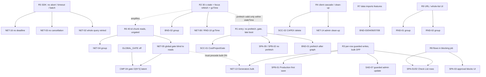

# 12 — Bottleneck dependency map

> Stage 1, 26 Nov 2026. Built by the orchestrator from the `Dependencies` fields of the 142 raw findings and the duplicate merges in doc 14. It shows which findings share a root, which ones are symptoms of another, and which cannot move until a decision, a probe or another finding is settled. It does not choose a remediation order: that is Stage 2.

## 1. Root causes and what hangs off them

Nine roots explain most of the 113 unique findings. IDs in **bold** are the P1 findings.

| Root | What it is | Findings that are symptoms of it | Blocked on |
|---|---|---|---|
| **R1. Screen-entry design: a screen's own reads start only after it renders** | The boot prefetch (D119 / PB-03) covers the session project and five PM screens, and only for a boot deep link. Cost screens, Production, Revenues, Finance and in-app rail navigation have none. Cost reads also wait behind `CostProjectGate`. The prefetch itself starts only after the 302 KiB gzip start-up graph has run. | **SCC-01** (= NET-01), SPA-09, SPB-02, BND-01, BND-09, RND-08, SPA-13 (= NET-22), BND-17 (= SAD-16), BND-12 group, SCC-15, SPB-05 | DEC-C (persisted reference data, held); prefetch is only valid inside `staleTime`, so it interacts with R2 |
| **R2. Freshness policy: 30 s `staleTime`, refetch on focus, default 5 min `gcTime`** | One global policy for every query. Returning to the tab after 30 s re-runs whole fan-out chains; reference data with a 15-30 min `staleTime` is still dropped 5 min after its screen closes. | BND-02 group (= NET-11, SCC-05, SPB-11), SAD-06, NET-08, RND-10 (= MEM-01), SCC-14; amplifies every T6 finding | DEC-F / DEC-3 (held: multi-user freshness is a product decision) |
| **R3. Write engine: one request per row, existence guard before each update, bulk switches OFF** | The guarded update (GET then PATCH) and per-row creates are the safe default; every bulk and merged-wave switch ships OFF pending a DEV test. | **NET-13** (= SPB-03), SPB-04 (= NET-19), SCC-09, SPA-06, SAD-07, SAD-08, SAD-09, SPB-07, SPB-08, SPB-15, **SPB-01**, SCC-06, **SPA-01**, **SPA-02**, SCC-12, SCC-13, SPA-14, SPB-10, SPA-17 | `GENERATORS-BULK-DEV-TEST-PLAN`, D165 T-40..T-43, D51 live acceptance (owed), product decisions on changed-rows-only (canvas `modifiedon` parity) |
| **R4. Cascade and clean-up work done by the client** | The client sends every child delete although the header delete cascades; the CAPEX Accounts clean-up is a browser loop. | **SCC-02**, SCC-08 (= NET-15), **NET-14** (= SAD-04), SAD-05 | DEC-A (cascade confirmed on DEV), D36 §1 lift (T-43) |
| **R5. SDK offers no abort, timeout or batch** | No `signal`, no deadline, no `$batch`, no changeset (D165 doc 01). | NET-16, NET-03 (= MEM-05), NET-02 (the whole query retries when one chunk fails), SAD-04 duration, the unknown-outcome risk of any deadline | Platform; cannot be removed in app code |
| **R6. Id-list reads in chunks of 40 with no gate on reads** | `ceil(N/40)` parallel requests per read, outside every concurrency gate (the global gate sees `sendWithPolicy` only). | NET-04 (= SCC-10, NET-12), NET-05, NET-07, SCC-11, SPB-13, CMP-04 (latent) | Probe P-1 (`In` function / larger chunks); `GLOBAL_GATE` off; a gate that covers reads |
| **R7. Module coupling: `data/` imports `features/`; barrels and facades** | The Generators rules barrel, the `costRepository` facade and data modules that import other screens' modules drag code into unrelated chunks. | BND-18 (root), BND-03, BND-04, BND-06, BND-07, BND-08, BND-10, SCC-19, BND-16 | None: structural, behaviour-neutral |
| **R8. Flows called inside a blocking job** | The Check List approval flows run inside the write job behind an overlay; the gate-cancellation flow has no Respond, so the call lasts the whole run. Flows are not to be modified. | **SPA-03**, NET-17, SPA-04 (= NET-18), SPA-01, SPA-02 (overlay length) | Flow duration (unmeasured); owner wording for the outcome (T-08) |
| **R9. URL-driven and whole-list UI state** | Filter boxes live in the URL; the shell is not memoised; combobox mounts every option; whole screens re-render per keystroke. | RND-01 group (= SPA-12, BND-15), RND-02 group (= CMP-08, SPA-15), RND-14, RND-05, SCC-20, SPB-17, SAD-17 | DEC-6 (municipality debounce held as a documented divergence); UT-OVUI-047 / UT-OVFIX-060 read the URL |

Not rooted in a bigger cause (stand alone): the CAPEX grid re-parse and repaint (CMP-01 group, CMP-02), `structuralSharing` walk (CMP-03 group), Add Cost sheet copies (MEM-02, MEM-03, CMP-05..07), `locale` cache keys (CMP-09), Tooltip volume (RND-04 group), `QueryStates` trace in render (RND-09), the map token wait (BND-05, SPA-16), App Insights start (BND-14), build chunk churn (BND-11), warm-up (BND-13 group).

## 2. Dependency graph

## 3. Chains that matter for ordering

1. **Gate before bulk.** A bulk switch ON puts hundreds of writes through the planned global gate. The gate is off (`GLOBAL_GATE`), is blind to the 17 read fan-outs (NET-05) and is quadratic in queued tasks (CMP-04: 15,000 queued writes cost 3.5 s of scheduling). Turning on bulk without addressing both would trade a latency problem for a throttling (HTTP 429) problem.
2. **Probe before chunk size.** NET-04 / SCC-10 / NET-12, SCC-11 and SPB-13 all wait for probe P-1 (`In` function, larger id lists) or a server-side aggregate. Their remedies cannot be chosen from source alone.
3. **Cancellation cannot be fixed in the app (R5).** A deadline (`REQUEST_DEADLINES`, OFF) only stops waiting; the request still runs, so a timed-out write has an unknown outcome. This limits what NET-16, SAD-04 and SAD-05 can ever achieve and rules out a naive "add timeouts" remedy for non-idempotent writes.
4. **Prefetch depends on the freshness policy.** R1 remedies (prefetch Cost / Production / Revenues / Finance reads, hover prefetch for in-app navigation) populate the cache with the 30 s `staleTime`; if the user takes longer than that to arrive, the prefetch is wasted and the focus refetch (R2) repeats it. Deciding DEC-F first, or giving prefetched reference data its own longer `staleTime`, determines how much R1 can gain.
5. **R7 unlocks the bundle items.** BND-18 (data layer importing feature modules) is why BND-03/04/06/07/08 exist; moving the helpers to `domain/` fixes several together and changes no behaviour.
6. **Flows set a floor.** SPA-03's duration is partly the flow's own run (5 to about 19 sequential connector levels to Respond, from the solution export 1.21.709). App-side remedies can only change what the user sees while the flow runs, not how long it takes, and need owner approval (T-08 wording).

## 4. Optimisation conflicts (where fixing one finding can worsen another)

| Pair | Conflict |
|---|---|
| Longer `gcTime` / `staleTime` (R2) vs memory (MEM-01, MEM-02) | Reusing the cost book across navigations holds 4.7 MB (typical) to 36.7 MB (stress) per project for longer. |
| Bulk writes (R3) vs round count | Finance with bulk on: 34 requests become 11 but rounds go from 6 to 7 (SPB-08): fewer requests, not lower latency. Bulk pays from roughly 100 rows (SPB audit). |
| Changed-rows-only writes (SPB-07/08, SPB-15, SAD-09) vs canvas parity | The canvas rewrites every row, so `modifiedon`/audit rows and server-plugin triggers change. Product decision (DEC / D79 style), not a free win. |
| Skip child deletes (R4, DEC-A) vs canvas parity and cascade rules | Depends on the cascade being confirmed on DEV; today's behaviour is canvas-faithful. |
| Remove the blocking reload (T5) vs consistency | Revenues and Finance wait for the reload because the next action needs the fresh rows; Production and Generators already do it in the background, so there is a precedent but each screen needs a busy guard (SPB-09). |
| Debounce the municipality search (RND-02) vs canvas parity | DEC-6 holds the debounce as a documented divergence; windowing the combobox (RND-14, FE-P1-02b) may change keyboard behaviour. |
| Memoising the shell (BND-15) / local filter state (RND-01) vs tests | UT-OVUI-047, UT-OVFIX-060 and PO-007 read the URL on each keystroke. |
| Global gate ceiling vs throughput | A single ceiling of 40 shared by reads and writes could slow the reads it was meant to protect; sizing needs probe P-4. |

## 5. Decision and probe gates (items that cannot start without them)

| Gate | Blocks |
|---|---|
| DEC-A (header-only Land Lease delete, cascade on DEV) | SCC-08 group |
| DEC-C (persisted reference data across tabs) | SPA-13 group |
| DEC-D (server-side Summary aggregate) | SCC-11 |
| DEC-F / DEC-3 (freshness and focus refetch) | BND-02 group, SAD-06 |
| D165 probes P-1..P-5 (never run) | NET-04 group, NET-16, the global gate sizing |
| `GENERATORS-BULK-DEV-TEST-PLAN` (never run on DEV) | NET-13 group |
| D51 live acceptance test (owed) | SCC-12, SCC-13 |
| Owner wording for flow outcome (T-08) | NET-17, SPA-03 |
| A browser Performance / Memory capture and App Insights data | Every SUSPECTED rendering and memory finding (RND-07, RND-13, MEM-03, SPB-17, SAD-17, SCC-20) |

## 6. Findings with no dependencies (candidates the audit found fixable in isolation)

Listed because their own `Dependencies` field names no product decision or probe (some name a related finding, an existing test or a prior ID, which Stage 2 must still check). This is an input to Stage 2, not a recommendation: BND-03, BND-04, BND-06, BND-07, BND-10 (import structure); CMP-05 (early return in `savedSheetPatch`); CMP-09 (cache key of pooled `Intl` helpers); RND-09 (trace written during render); SCC-06 (existence guards one after another on the Land Lease panel Save); SPB-09 (close the dialog before the reload on Revenues/Finance, with a busy guard); SAD-02 and SAD-11 (queries gated on data they do not use); SCC-15, SCC-16, SCC-18 (query keys and duplicate reads); SAD-15 (three reads of the same list per edit cycle).
